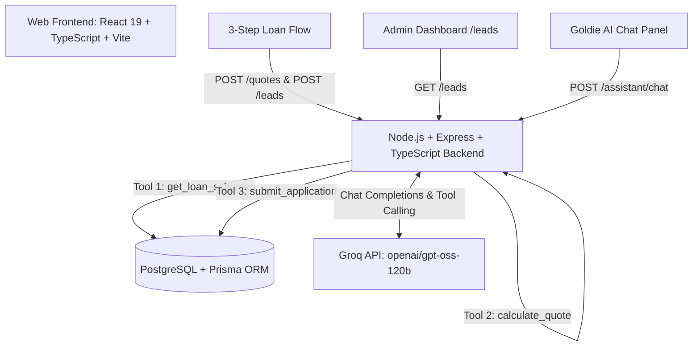

# AuLoanDesk — Institutional Gold Loan Portal & AI Assistant

AuLoanDesk is an institutional-grade, full-stack digital gold loan origination platform developed for TGlobal Technologies. The platform combines a structured 3-step application workflow, an administrative leads queue, and an intelligent AI Gold Loan Assistant powered by Groq and the `openai/gpt-oss-120b` model.

---

## Architecture Overview



---

## Key Highlights & Phases

1. **Phase 1: Backend Foundation**:
   - Modular Express application architecture in TypeScript with ESM.
   - Comprehensive middleware stack: Helmet security headers, CORS origin whitelisting, Zod payload validation, and centralized error handling.

2. **Phase 2: Database & Financial Calculation Engine**:
   - PostgreSQL schema with Prisma ORM migrations and seeding.
   - Seeded schemes:
     - `PLAN_BULLET_01`: Bullet Repayment, 12% p.a., 12-month tenure, 70% Max LTV.
     - `PLAN_EMI_01`: Monthly EMI, 10.5% p.a., 12-month tenure, 75% Max LTV (RBI compliant ceiling).
   - High-precision financial calculations using `Decimal.js` and integer rounding.

3. **Phase 3: Backend REST APIs**:
   - `GET /api/v1/loan-schemes`: Fetches active schemes.
   - `POST /api/v1/quotes`: Debounced calculation endpoint.
   - `POST /api/v1/leads`: Lead ingestion with 7-day mobile lockout and number masking.
   - `GET /api/v1/leads`: Filterable administrative queue.

4. **Phase 4: Frontend Application**:
   - Clean slate/gold institutional aesthetic built using React 19, Tailwind CSS v4, and Vite.
   - 3-step responsive guided flow: Applicant Details $\rightarrow$ Live Debounced Quotes $\rightarrow$ Review & Explicit Confirmation.
   - Admin leads dashboard with search filter, masked mobile display, and application detail modals.

5. **Phase 5: Groq-Powered AI Loan Assistant ("Goldie")**:
   - Backend-orchestrated tool-calling agent using Groq's `openai/gpt-oss-120b`.
   - Built-in floating chat widget that allows seamless interaction without disrupting the guided application flow.
   - Strict guardrails: non-authoritative calculations, explicit confirmation enforcement, duplicate detection, and domain exclusivity.

6. **B1: Backend Hardening & Production Reliability**:
   - **Idempotency Protection**: `Idempotency-Key` header on `POST /api/v1/leads` with PostgreSQL transaction-level advisory locks, deterministic canonical payload hashing, and rejection of conflicting payload reuse (HTTP 400 `IDEMPOTENCY_PAYLOAD_MISMATCH`).
   - **Concurrency-Safe Duplicate Detection**: Database-backed serialization via `pg_advisory_xact_lock` guaranteeing that simultaneous submissions for the same mobile produce exactly one creation (201) and subsequent requests receive HTTP 409 Conflict (`DUPLICATE_APPLICATION`) with `existingApplicationId`.
   - **Application Status Workflow**: Enforced state machine (`SUBMITTED → UNDER_REVIEW → APPROVED` or `REJECTED`) via `PATCH /api/v1/leads/:id/status`.
   - **Audit Log Trail**: Every status transition is atomically logged in `application_status_audits` in the same transaction, retrievable via `GET /api/v1/leads/:id/audits`.
   - **Authoritative Cached Gold-Rate**: `GET /api/v1/gold-rate` serving the benchmark ₹7,000/g rate with 5-minute in-memory TTL caching and cache metadata.

---

## AI Assistant Configuration (Groq)

### Environment Variables
Configure the following keys in `backend/.env` (refer to `backend/.env.example`):

```ini
# AI Assistant Configuration (Groq)
GROQ_API_KEY=your_groq_api_key_here
GROQ_MODEL=openai/gpt-oss-120b
```

> **Security Note:** `backend/.env` is strictly excluded from version control in `.gitignore`. Never commit API keys or credentials.

### Registered AI Tools
The assistant is constrained to three backend-enforced tools:
1. `get_loan_schemes()`: Fetches database-backed schemes. The assistant is prohibited from describing or inventing unlisted schemes.
2. `calculate_quote(netWeightGrams, grossWeightGrams, karat)`: Calls the authoritative financial service. Enforces $0 < \text{net} \le \text{gross} \le 1000\text{g}$ and karat $\in \{18, 22, 24\}$.
3. `submit_application(payload)`: Ingests the application into PostgreSQL. Requires `userConfirmed: true` following an explicit display of the full summary.

---

## Getting Started

### Prerequisites
- Node.js 20+ (ESM compatible)
- PostgreSQL 14+
- Groq API Key

### 1. Database Setup
Ensure PostgreSQL is running locally and set `DATABASE_URL` in `backend/.env`:
```bash
cd backend
npm install
npx prisma migrate dev
npm run db:seed
```

### 2. Run the Backend Service
```bash
cd backend
npm run dev
# Server boots at http://localhost:4000
```

### 3. Run the Frontend Application
```bash
cd frontend
npm install
npm run dev
# Application accessible at http://localhost:5173
```

---

## Testing & Quality Verification

### Run Backend Tests (Vitest)
Executes 64 unit, financial, API, B1 concurrency & hardening, and conversational AI flow tests:
```bash
cd backend
npm run test
```
Test Suites:
- `test/backend-hardening.test.ts`: Idempotent retries, conflicting payload rejection, concurrent key safety, concurrent mobile race serialization, status state machine validation, transactional audit persistence, and gold rate cache.
- `test/loan-api.test.ts`: REST endpoints, validations, scheme queries, server recalculation, duplicate 7-day lockout.
- `test/loan-calculator.test.ts`: Precision calculations, net/gross assertions, LTV limits, RBI ceilings.
- `test/ai-assistant.test.ts`: Groq assistant orchestration, tool calling guardrails, affirmative confirmation enforcement.
- `test/health.test.ts`: Health check probe and system status.

### Run Linters & Typecheck
```bash
# Backend
cd backend
npm run lint
npm run typecheck

# Frontend
cd frontend
npm run lint
npm run build
```

---

## Regulatory Compliance & Safeguards
- **RBI LTV Ceiling**: Max loan-to-value is strictly capped at 75% of assessed 24K collateral value.
- **7-Day Anti-Duplicate Lockout**: Re-applications with the same mobile number within 7 days are rejected with HTTP 409 (`DUPLICATE_APPLICATION`).
- **Data Privacy**: Mobile numbers are masked in all administrative lists and AI responses (e.g., `9876XXXX10`).
